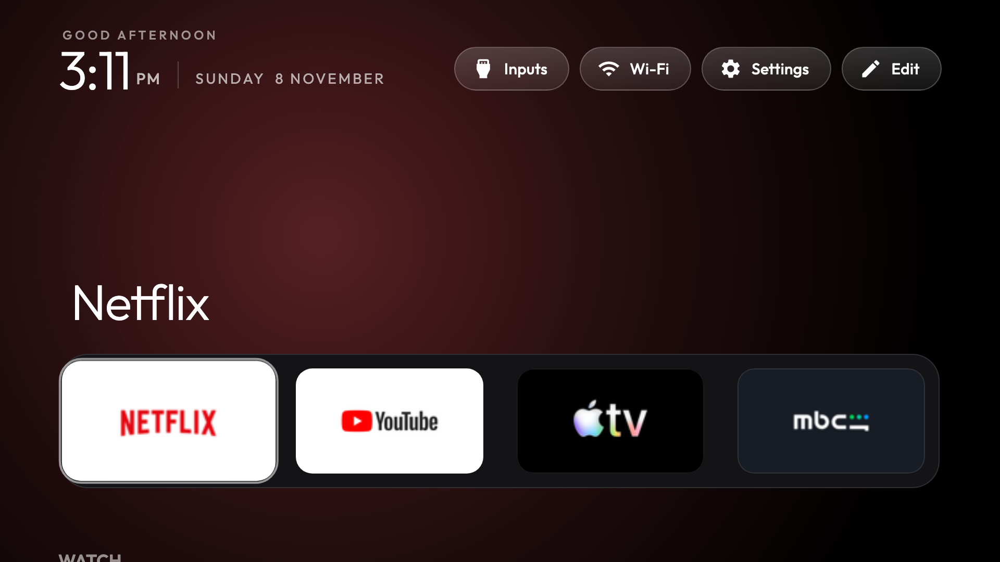
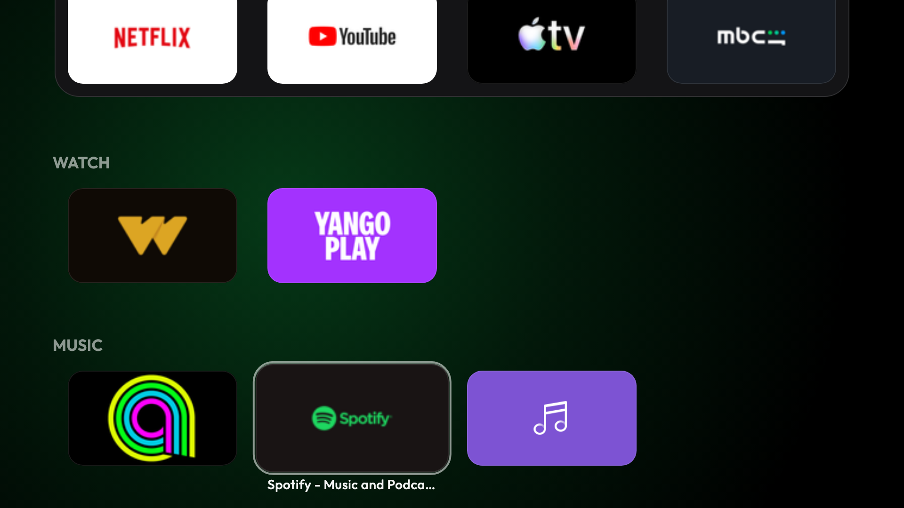

# webOS_ui

An Apple TV-style home screen for TVs, installed through LG's own Developer Mode — no root, and
deleting the Developer Mode app removes every trace of it.

Built and tested on an **LG 43LM6300PVB, webOS 4.5** (firmware 05.40.97), whose browser engine is
roughly Chromium 53 — so everything here is written to run on an engine from 2016.



## What it does

- **A tvOS layout.** A top row of four apps with the focused app's name above it, a glow in that
  app's colour behind everything, your apps in categories below, and Inputs (HDMI ports and Live
  TV), Wi-Fi and Settings in a row of frosted pills. The header slides away as the grid scrolls up
  into it, and one glass ring springs between tiles as the focus moves.
- **The top row is what you open.** It is not a hand-pinned dock: the launcher counts how often you
  open each app, with a three-day half-life, and the four it lands on sit at the top — as well as
  in their own category, so nothing moves out of where you look for it. `dockApps` in `config.js`
  fills the row until there is enough history. Nothing leaves the TV: the count lives in the app's
  own `localStorage`.
- **Categories.** `config.js` takes a `categories` list; the grid grows a heading per section and
  anything uncategorised collects under `otherTitle`.
- **Rearranging in two steps.** The **Edit** pill, or holding OK on a tile, turns arranging on and
  it stays on: the arrows walk the grid, OK takes a tile in hand, OK again puts it down, and Back
  leaves. A tile carried into another section joins it, and the arrangement is saved per section.
  The top row is the launcher's own and is not rearranged by hand.
- **Tile and glow colours measured ahead of time** (`bake-colors.py`). Sampling an icon's pixels in
  the browser does not work here: webOS serves the app from `file://`, where `getImageData()`
  throws on a tainted canvas, and every tile falls back to its declared colour — plain black for
  several apps. The colours are computed on the computer during `install.sh` and written into
  `apps.js` instead.
- **A held OK is recognised on any remote.** webOS remotes disagree about what a held key sends:
  one keydown, repeating keydowns, or keydown/keyup pairs. The hold is timed from the first
  keydown, and the press counts as over only once nothing has arrived for 180 ms.
- **Written for webOS 4.5.** The `inset` shorthand needs Chrome 87; on 4.5 it is ignored, which
  collapses a positioned layer to 0×0 and clips everything inside it. Positioning is longhand
  `top/right/bottom/left` throughout.



## What webOS allows

webOS is more locked down than Android TV, and three things follow from that:

- **Installing** goes through LG's **Developer Mode** app and a free LG developer account.
- **The app list** is read from your computer by `sync-apps.py` and bundled into the package —
  webOS does not let an app list what else is installed.
- **The Home button** always opens LG's home. `home-watch.py`, running on another device on the
  same network, switches straight back (about 0.1 s).

There is no debloat step: webOS has no ADB-style package disabling. Turn off LG's ads in the TV's
own settings instead (see [Cleaning up LG's home](#cleaning-up-lgs-home)).

## Setup

You need a Mac on the same Wi-Fi as the TV, with Node.js (for LG's `ares` CLI, fetched with `npx`)
and Python 3. The steps are macOS only for now: `install.sh` makes the app icon with `sips`.

**1. Developer Mode on the TV**

1. Create a free account at [webostv.developer.lge.com](https://webostv.developer.lge.com).
2. On the TV, install **Developer Mode** from the LG Content Store and sign in.
3. Turn on **Dev Mode Status** (the TV restarts), open the app again and turn on **Key Server**.
   Note the **IP address** and **Passphrase** it shows.

**2. Connect your computer** (once)

```bash
export TV_HOST=192.168.1.50                       # the IP from the Developer Mode app
npx -y -p @webos-tools/cli ares-setup-device -a lgtv -i "{'host':'$TV_HOST','port':'9922','username':'prisoner'}"
npx -y -p @webos-tools/cli ares-novacom --device lgtv --getkey        # type the passphrase
npx -y -p @webos-tools/cli ares-setup-device -m lgtv -i "{'privatekey':'lgtv_webos','passphrase':'ABC123'}"
```

**3. Install**

```bash
git clone https://github.com/EngSharaqi/webOS_ui.git
cd webOS_ui
python3 -m venv venv && venv/bin/pip install websockets pillow
TV_HOST=192.168.1.50 ./install.sh
```

The first run shows an "allow this device?" prompt on the TV: accept it. That pairing lets
`sync-apps.py` read your apps and icons. `install.sh` then measures the icon colours, packages the
app, installs it and opens it. Run it again whenever you install or remove apps on the TV.

**4. A one-press shortcut**

With the launcher open, hold a number key on the remote (say **1**) and assign it. From then on,
holding 1 opens the launcher from anywhere.

## The Home button

webOS hard-wires Home to LG's home, and blocks Developer Mode apps from seeing which app is in
front, so the TV cannot redirect it on its own. [`home-watch.py`](home-watch.py) does it from
another always-on device on the same network: it watches the TV's foreground app and, the moment
LG's home appears, opens the launcher on top.

- **Press Home twice** within three seconds to stay on LG's home, for its menus.
- When the TV powers on to LG's home, it goes to the launcher too.
- When the watcher isn't running, Home simply opens LG's home as usual.

On a Mac, install it as a background service that starts at login:

```bash
TV_HOST=192.168.1.50 ./home-watch-mac.sh       # install or update
./home-watch-mac.sh uninstall                  # remove
```

macOS will ask for Local Network access for Python: allow it (System Settings → Privacy & Security
→ Local Network), or the watcher logs "No route to host". The log is at
`~/Library/Logs/webos-ui-home-watch.log`. A Mac only redirects Home while it is awake and at
home; for every time, run `python3 home-watch.py 192.168.1.50` on something that is always on, such
as a Raspberry Pi.

## Using it

**Move around** with the arrows; **OK** opens an app. From the top row, **up** goes to the pills.

**Rearrange tiles on the TV**: the **Edit** pill, or holding **OK** on a tile, starts arranging.
Then the arrows move between tiles, **OK** takes one in hand (it wiggles) and **OK** puts it down,
including in another category; **Back** cancels a tile in hand, and **Back** again leaves
arranging. The order is saved on the TV.

**Configure** in [`app/config.js`](app/config.js): the categories, the apps that fill the top row
until the TV knows what you watch, apps to hide, the Live TV app and the number of columns. App ids
come from `venv/bin/python sync-apps.py $TV_HOST --list`. Changing the category titles or
`dockApps` resets an order arranged on the TV.

## Cleaning up LG's home

For when you do land on it. Names vary a little by webOS version:

- **Settings → General → System → Additional Settings → Home Settings**: turn off **Home
  Promotion** and **Content Recommendation**.
- **Settings → Support → Privacy & Terms → User Agreements**: untick **Viewing Information** and
  **Interest-Based Recommendations**.

## Troubleshooting

- **Pairing fails with "403 Pairing rejected: blacklisted certificate detected".** Newer firmware
  rejects the signed manifest that open-source LG clients share. `lgtv.py` pairs with an unsigned
  one, which still works.
- **No pairing prompt on the TV.** Turn on the TV's option for connecting from mobile apps
  (Settings → General → Devices → External Devices; named "LG Connect Apps" or similar).
- **`ares` says "All configured authentication methods failed".** The device profile is missing
  its key: run the third command in step 2 again.
- **Tiles come out black.** `bake-colors.py` needs Pillow: `venv/bin/pip install pillow`, then run
  `install.sh` again.
- **Apps stop opening after a while.** Developer Mode sessions expire — on webOS 4.5 after 50
  hours. Open the Developer Mode app and press **Extend Session Time**.

## Files

| File | What it does |
|---|---|
| [`app/`](app/) | The launcher: `index.html`, `style.css`, `app.js`, `config.js`, `appinfo.json` |
| [`install.sh`](install.sh) | Syncs your apps, measures the colours, packages and installs the launcher, and opens it |
| [`sync-apps.py`](sync-apps.py) | Reads apps, icons and HDMI inputs from the TV into `app/apps.js` and `app/icons/` |
| [`bake-colors.py`](bake-colors.py) | Measures each icon's tile and glow colour into `app/apps.js` (needs Pillow) |
| [`home-watch.py`](home-watch.py) | Sends the Home button to the launcher |
| [`home-watch-mac.sh`](home-watch-mac.sh) | Runs the watcher as a macOS background service |
| [`lgtv.py`](lgtv.py) | Pairs with and talks to the TV's remote-control service |
| [`assets/icon.jpg`](assets/icon.jpg) | The app icon, resized to PNG by `install.sh` |

## License

MIT — see [`LICENSE`](LICENSE), which carries the copyright notices this code is released under.
The Outfit font is under the SIL Open Font License ([`app/fonts/OFL.txt`](app/fonts/OFL.txt)).
